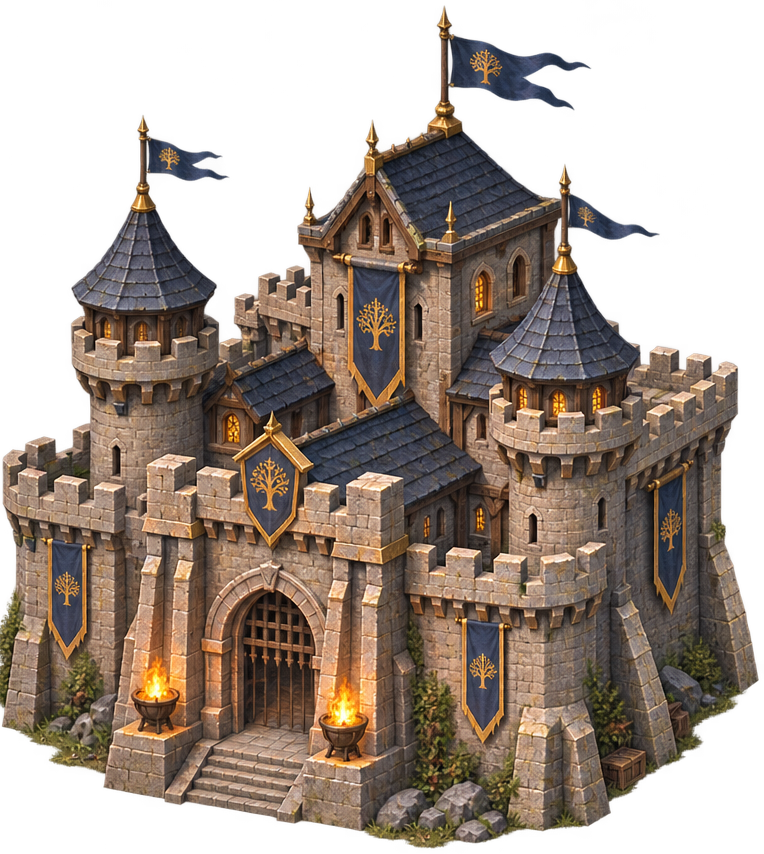
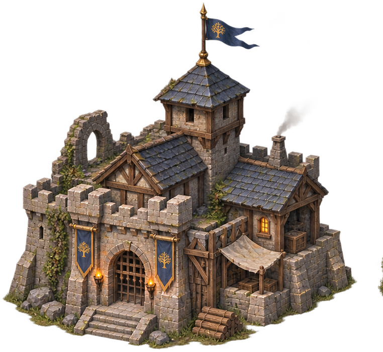
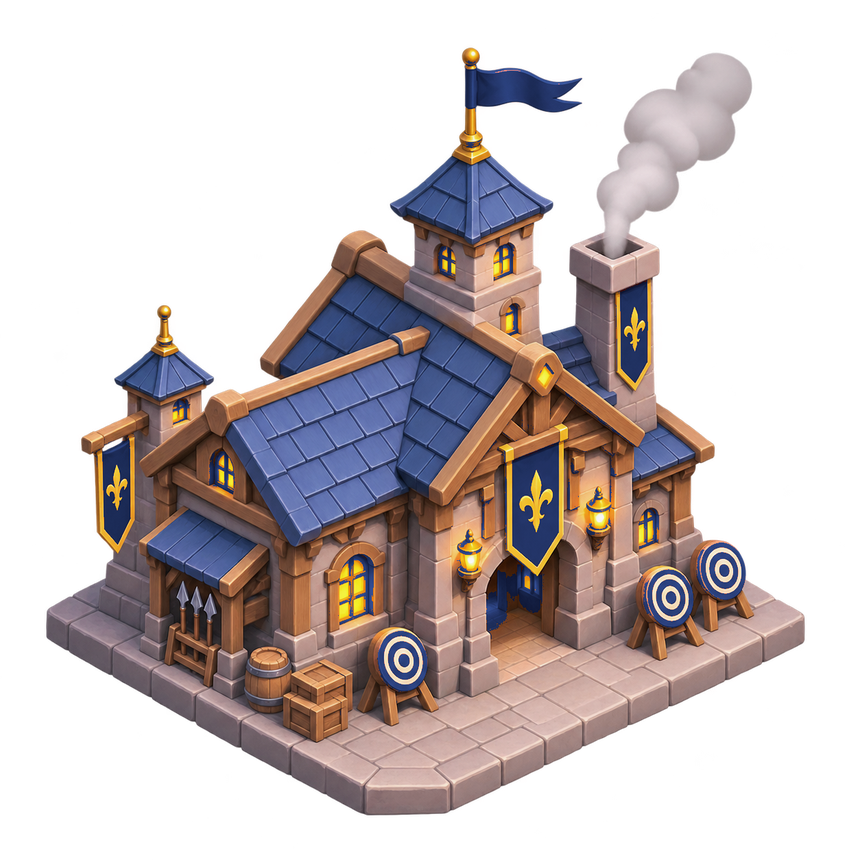
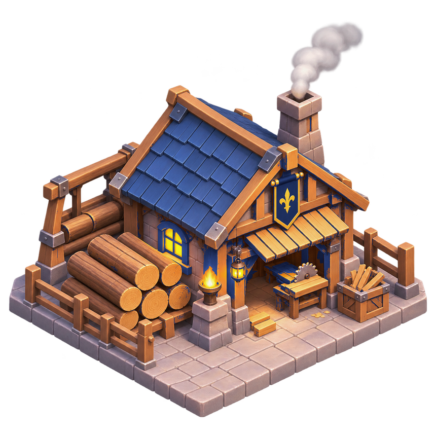
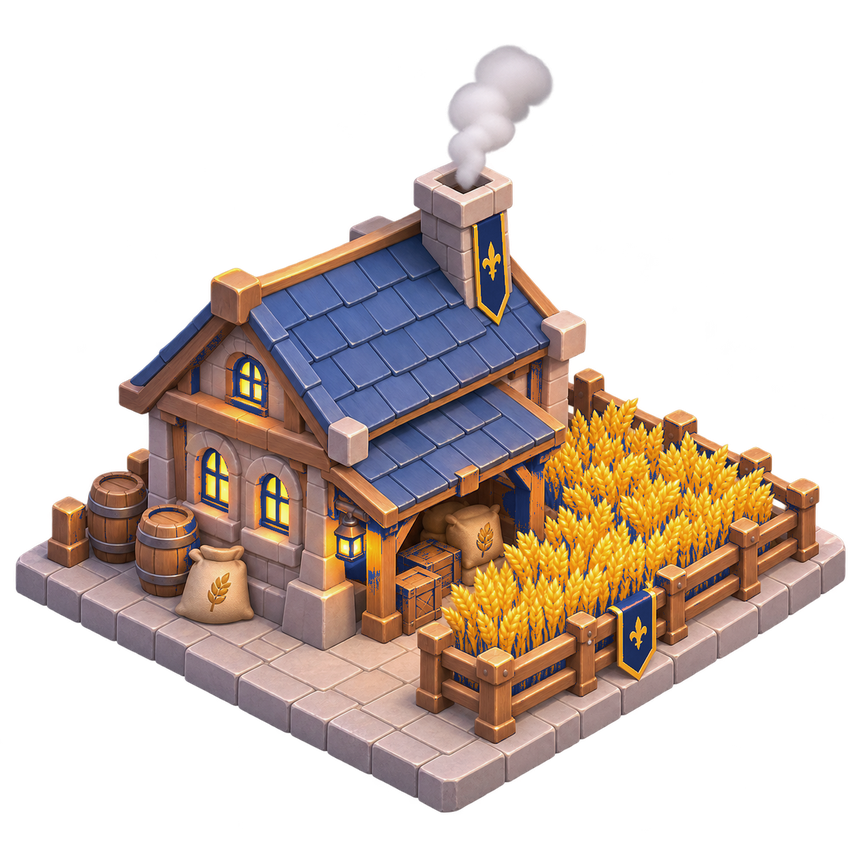
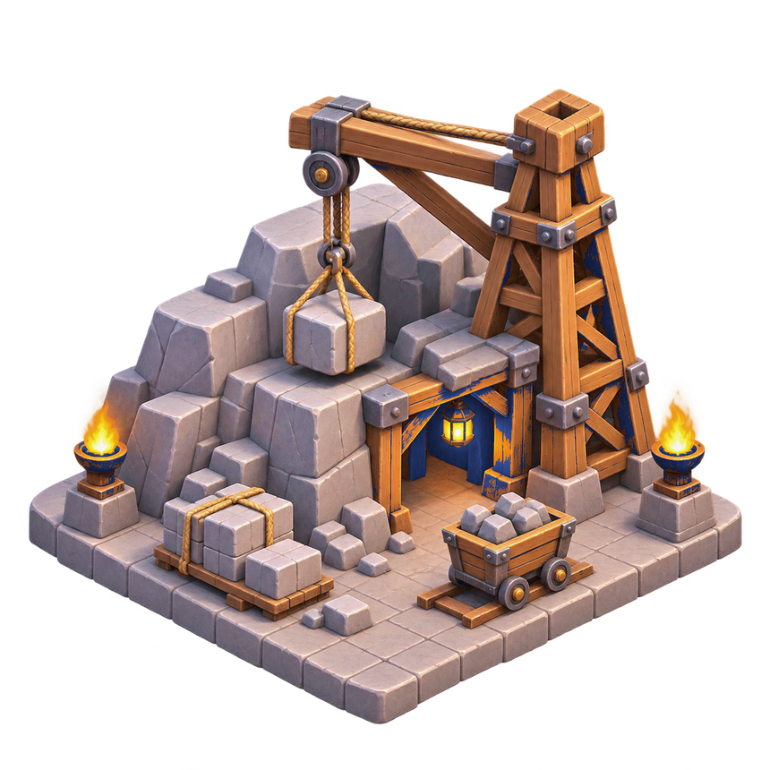

# Biblia Visual de Valoria · v1.0 · 17/11/2026

**Estado:** identidad de referencia **congelada**, método de nuevas generaciones **en validación**. Las imágenes maestras son ilustraciones originales del experimento ya elegidas por el propietario como patrón artístico; esto **no aprueba** automáticamente nuevos sprites, ni el juego, ni una técnica. Rama aislada `art/ciudad-2d-hitos-1-5-20261116`; no tocar `main`.

## 0. Maestros visuales inmutables
Las imágenes están COPIADAS como blobs idénticos, no son enlaces temporales. Comprobar SHA-256 en `master_manifest_v1.json`. Orden de autoridad: **Bastión V → Bastión I → Cuartel/Aserradero/Granero/Cantera**; si un detalle de un secundario contradice Bastión V, prevalece el primero. Procedencia histórica: originales del repo, generación IA exacta no recuperada con pruebas suficientes; NO inventar seed ni modelo histórico.

| Maestro | Función | Referencia renderizada |
|---|---|---|
| Bastión V | Siluetas, material, profundidad, sombra |  |
| Bastión I | Continuidad de progresión |  |
| Cuartel | Heráldica, arcos, tejados |  |
| Aserradero | Vigas, talleres, recursos |  |
| Granero | Actividad, escala civil |  |
| Cantera | Materialidad y espacio productivo |  |

## 1. Perspectiva y cámara
- Lectura **isométrica ilustrada 3/4** con proyección aparente ortográfica, verticales casi paralelas, frontal y lateral visibles; sin horizonte dentro del sprite ni fuga fotográfica fuerte.
- Los parámetros **30–40° de elevación son una hipótesis inicial**, no una medición de Blender/Unity equivalente: la calibración se aprueba por coincidencia de las pendientes de tejados y la huella vista desde el mismo encuadre, nunca solo por indicar «isométrico».
- Regla práctica: base visual centrada (pivot `foot=(0.5,0)` después de recortar); fachada principal legible en el cuadrante inferior; margen exterior de 3–5 % del encuadre, sin cortar aleros, estandartes ni humos. Render ortográfico 1:1 con **frente y lateral estables**.
- En Unity, PPU actual = 100, `SpriteAlignment.BottomCenter`, filtrado bilineal sin mipmaps, `FullRect`, compresión desactivada solo en sandbox; comparar en cámara I–V y **no deducir calidad física** de capturas Editor.

## 2. Arquitectura distintiva
- **Valoria**: piedra de mampostería irregular con arcos de medio punto y jambas fuertes; cubiertas de pizarra azul profunda y aleros pesados, carpintería de roble oscuro vista, remates de latón envejecido, heráldica azul/oro y ventanas con luz interior.
- Una silueta funcional diferente para cada edificio (forja = chimenea/horno abierto; observatorio = torre elevada e instrumentos; archivo = dos alas/ventanales). No repetir torre, tejados o portón como un clon; variar masa conservando lenguaje.
- Evitar cubos apilados, torres genéricas sin función, despiece de maqueta, bordes lineales negros propios del cartoon, paneles imposibles o tejados huecos.

## 3. Paleta y texturas
Colores de guía en sRGB (centros de diseño visual; **no son colores pixel-perfect extraídos de un atlas certificado**):
- piedra iluminada `#B89C7C`; piedra en sombra `#584C4D`; caliza/relieve `#D1BBA1`;
- madera de roble `#76452E`; madera fresca `#A56637`;
- pizarra índigo `#344E80`; heráldica azul `#142A61`; metal antiguo/dorado `#D4A449`;
- emisivo de ventanas `#FFBA66`; violeta limitado de la Brecha `#7756BA`;
- ambiente vegetal `#50683E` (solo accesorio; no hornear césped rectangular).
Textura microvariada e imperfecta, mampuestos con juntas y desgaste, tablones con veta legible, tejas individuales y pátina; evitar superficies totalmente lisas y saturación de juguete.

## 4. Iluminación
- Atardecer cálido direccional desde **arriba-izquierda del encuadre**, volumen recibido en tejados y fachadas visibles. Sombras proyectadas azul-violeta, relleno moderado.
- Ventanas, horno y antorchas cálidas: puntos de interés, no exposición global. Luz de la Brecha violeta **solo cuando la función/lore lo amerita**.
- No aplicar filtros de color indiscriminados para ocultar incoherencia; analizar primero exposición y material del sprite original.

## 5. Suelo y sombras
- **Prohibidos**: plataforma cuadrada/romboidal uniforme, baldosa con bordes visibles, hierba rectangular, mate opaco alrededor, halo blanco o gris en bordes.
- La huella del edificio debe terminar en su propia base orgánica (cimientos escalonados verdaderos, escalones funcionales, elementos con apoyo). La **sombra de contacto es una capa RGBA independiente**, centrada respecto a la huella, blanda y sin rectángulo ni fuga excesiva.
- La sombra debe apoyar en el terreno sin tapar caminos; delante se pueden colocar dos props de vegetación independientes, pero no deben funcionar como parche para una base mal generada.
- Probar el alfa sobre **negro, gris 50 %, verde, y suelo orgánico real**. Si hay halos visibles a 100 % en cualquiera, rechazar/reprocesar recorte.

## 6. Acabado pictórico y calidad
- Textura y juntas reconocibles a tamaño normal de iPhone (390×844) y a 1170×2532; bordes antialias correctos; sombras/materiales de peso visual similar a Bastión V.
- Aumentar resolución mediante upscaling NO demuestra detalle real. Contraste Laplaciano, tamaño/alpha y nitidez son métricas diagnósticas, **jamás puntuación artística**.
- Silueta característica identificable sin texto ni HUD, y no confundible con cualquier otro edificio existente.

## 7. Heráldica
- Motivo vegetal/solar dorado **sobre paño o escudo azul oscuro**, remates de latón. No cambiar a rojo, símbolos modernos ni logotipos nuevos arbitrariamente.
- Pendones pequeños coherentes con el viento y dirección de sombra. Heráldica no sustituye a la identidad arquitectónica.

## 8. Escala, recorte y exportación
- Fuente de un solo edificio aislado; guardar PNG original y metadatos **sin sobreescribir**. Salida final RGBA, fondo transparente (alpha mínimo 0, alpha máximo 255), pivot de pie explícito, al menos 2 % de margen transparente sin recortar aleros.
- Regla de escala: integrar con `city_layout.json` sin cambiar posiciones ni gameplay. La altura y anchura aparentes se calibran **por huella/muros** frente al Bastión y edificio A, no por dimensión total que incluye una antena o humo.
- Guardar original, máscara, sprite RGBA, sombra en archivo separado y prueba A/B. Import Unity limitada al sandbox; no tocar Build Settings ni escenas principales.

## 9. Criterios de aceptación y rechazo
**Bloqueos técnicos**: no PNG RGBA, alfa/matte incorrectos, recorte de la silueta, pivote desconocido, fuente sin referencia/hash, `SpriteRenderer` invisible, collider/selección/progresión cambiados, ruptura de CI o cambios en `main`.
**Evaluación artística sobre 10**: lectura/identidad 2; perspectiva 1.5; coherencia de luz 1; materiales/paleta 1.5; detalle/riqueza 1.5; contacto con suelo 1.5; escala/nitidez móvil 1. Requerir **≥8/10 en cada uno de los tres** y ausencia de bloqueos, más revisión comparativa junto a Bastión V. La puntuación es criterio de revisión propuesto, no valor medido ni aprobado actualmente.

## 10. Procedimiento y evidencia
Ver `REPRODUCIBLE_ART_PIPELINE.md` y `pilot_three_buildings.json`. Realidad técnica heredada: [PlayMode + 15 A/B editor CAPTURES 44028864959](https://github.com/mt5hjfz2kb-lab/Eldoria-Prewiu/actions/runs/44028864959), [comparativa Blender PBR 44033293154](https://github.com/mt5hjfz2kb-lab/Eldoria-Prewiu/actions/runs/44033293154). Ninguna de esas ejecuciones aprueba la calidad ni corresponde a la futura integración de los tres nuevos edificios.

## 11. Qué hemos aprendido de las referencias
Documentación Runway: las referencias se pueden guardar y reutilizar, pero **no garantizan identidad estricta**. El éxito se verifica comparando la misma perspectiva, material y luz por edificio y generando capturas reales. No depender de URL temporal con `_jwt` como procedencia definitiva: guardar ID de tarea, SHA y PNG original. Referencias: https://help.runwayml.com/hc/en-us/articles/40042718905875-Creating-with-Gen-4-Image-References y https://help.runwayml.com/hc/en-us/articles/52963720640275-Using-reference-media-to-guide-your-generations .
