# Eldoria — Galería de 26 GLB canónicos (geometría real)

**Estas miniaturas se generan de la malla GLB; materiales/luces no son Unity y no constituyen ART_APPROVED.**
Para juzgar belleza y escala hay que usar cámara real en Unity; este visor sirve para reconocer rápidamente formas antes de regenerarlas.

## Valoria_HeroBastion_v1

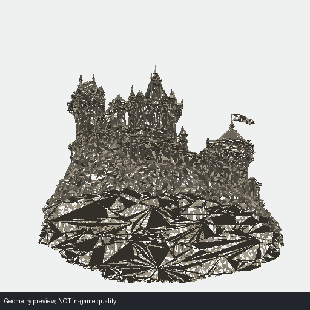

**Uso registrado:** Valoria central fortress. **Clasificación:** `USE_PRODUCTION`.

**Archivo:** `Unity/Assets/Eldoria/Resources/Valoria/HeroBastionGenerated/Valoria_HeroBastion_v1.glb`.

**Limitación:** Validated hero anchor; do not replace with older silhouette..

## GateStreetRiseRock_MV1

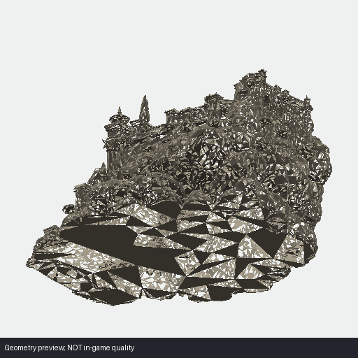

**Uso registrado:** Monumental entrance fragment. **Clasificación:** `LANDMARK_ONLY`.

**Archivo:** `Unity/Assets/Eldoria/Resources/Valoria/HistoricalLandmarks/GateStreetRiseRock_MV1.glb`.

**Limitación:** Documented traversal/interface failure; no use as stand-alone passable route..

## Piece01

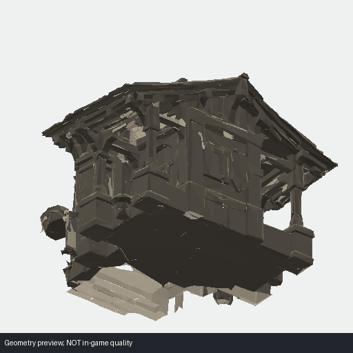

**Uso registrado:** Valoria modular mid-tier wall/building. **Clasificación:** `REUSE_CONDITIONAL`.

**Archivo:** `Unity/Assets/Eldoria/Resources/Valoria/MidTierArchitectureKit_v1/Piece01.glb`.

**Limitación:** Four selected good source modules; support compact approved topology only..

## Piece02

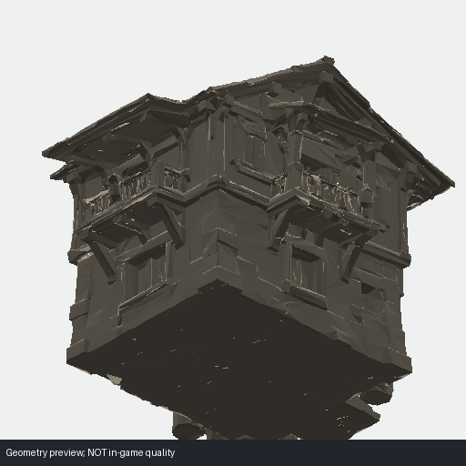

**Uso registrado:** Valoria modular mid-tier wall/building. **Clasificación:** `REUSE_CONDITIONAL`.

**Archivo:** `Unity/Assets/Eldoria/Resources/Valoria/MidTierArchitectureKit_v1/Piece02.glb`.

**Limitación:** Four selected good source modules; support compact approved topology only..

## Piece03

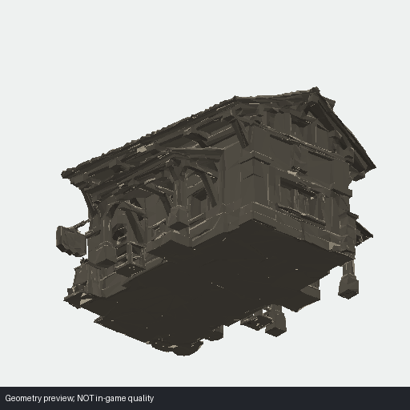

**Uso registrado:** Valoria modular mid-tier wall/building. **Clasificación:** `REUSE_CONDITIONAL`.

**Archivo:** `Unity/Assets/Eldoria/Resources/Valoria/MidTierArchitectureKit_v1/Piece03.glb`.

**Limitación:** Four selected good source modules; support compact approved topology only..

## Piece04

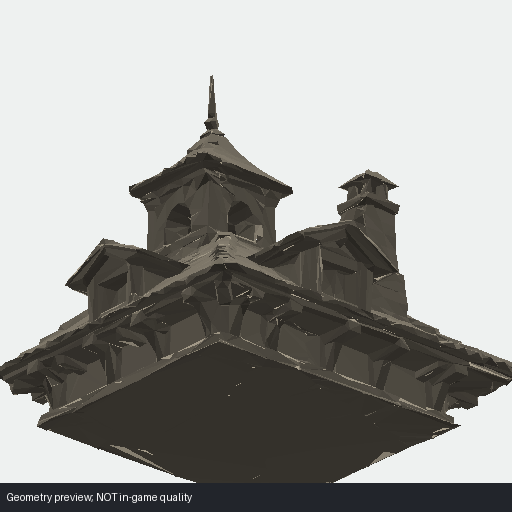

**Uso registrado:** Valoria modular mid-tier wall/building. **Clasificación:** `REUSE_CONDITIONAL`.

**Archivo:** `Unity/Assets/Eldoria/Resources/Valoria/MidTierArchitectureKit_v1/Piece04.glb`.

**Limitación:** Four selected good source modules; support compact approved topology only..

## ResidentialTerraceRock

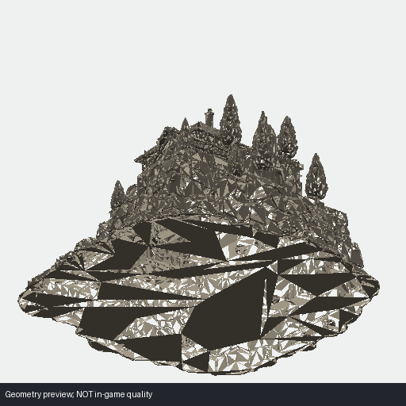

**Uso registrado:** inhabited/civic support mass inside already-approved production topology. **Clasificación:** `REUSE_CONDITIONAL`.

**Archivo:** `Unity/Assets/Eldoria/Resources/Valoria/Rescued/ResidentialTerraceRock.glb`.

**Limitación:** not a certified through-street module; do not force topology to fit it.

## RockTerrainSeamFiller

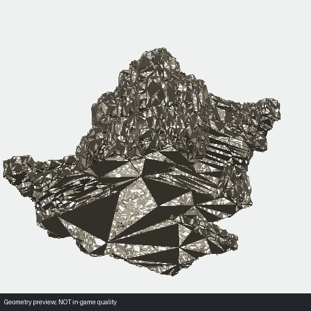

**Uso registrado:** terrain seam burial/overlap around production buildings and terraces. **Clasificación:** `REUSE_CONDITIONAL`.

**Archivo:** `Unity/Assets/Eldoria/Resources/Valoria/Rescued/RockTerrainSeamFiller.glb`.

**Limitación:** not a standalone landmark or path.

## StreetLandingTransition

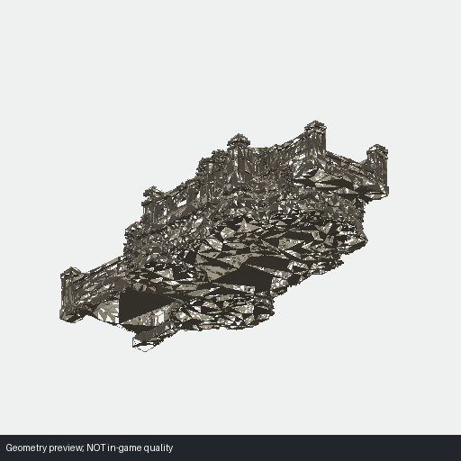

**Uso registrado:** visual street/landing dressing over an independent gameplay route. **Clasificación:** `REUSE_CONDITIONAL`.

**Archivo:** `Unity/Assets/Eldoria/Resources/Valoria/Rescued/StreetLandingTransition.glb`.

**Limitación:** heavy parapets and no interface certification; never trust as sole traversable connector.

## TerraceStairRock

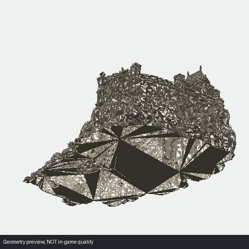

**Uso registrado:** visual vertical transition/terrace fragment where gameplay route already exists independently. **Clasificación:** `REUSE_CONDITIONAL`.

**Archivo:** `Unity/Assets/Eldoria/Resources/Valoria/Rescued/TerraceStairRock.glb`.

**Limitación:** interface not certified; do not use mesh to define traversal.

## TowerWallRock

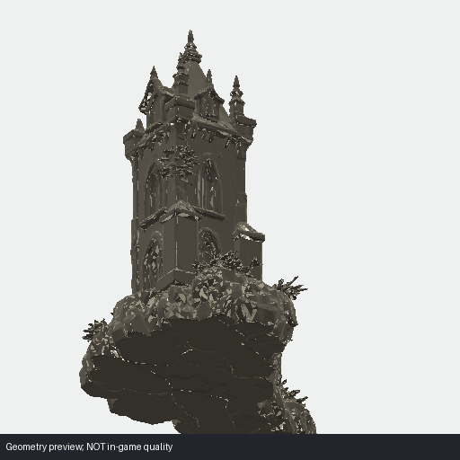

**Uso registrado:** defensive skyline accent / wall-rock anchor. **Clasificación:** `REUSE_CONDITIONAL`.

**Archivo:** `Unity/Assets/Eldoria/Resources/Valoria/Rescued/TowerWallRock.glb`.

**Limitación:** overuse makes Valoria fortress-only; no circulation role.

## CornerWallL

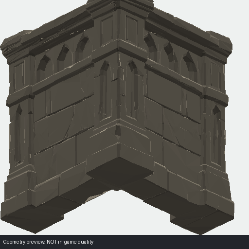

**Uso registrado:** Valoria retaining masonry / wall. **Clasificación:** `REUSE_CONDITIONAL`.

**Archivo:** `Unity/Assets/Eldoria/Resources/Valoria/StoneArchitectureKit_v1/CornerWallL.glb`.

**Limitación:** Certified three-piece subset; rejected siblings must not be restored..

## HighStraightWall

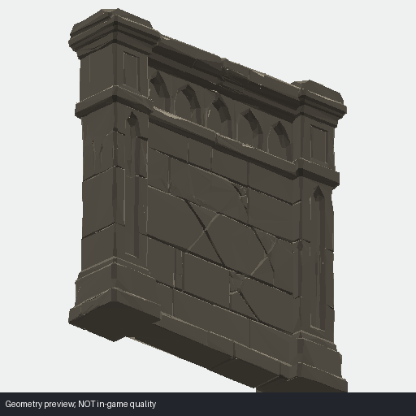

**Uso registrado:** Valoria retaining masonry / wall. **Clasificación:** `REUSE_CONDITIONAL`.

**Archivo:** `Unity/Assets/Eldoria/Resources/Valoria/StoneArchitectureKit_v1/HighStraightWall.glb`.

**Limitación:** Certified three-piece subset; rejected siblings must not be restored..

## RockToWallTransition

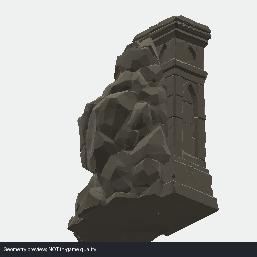

**Uso registrado:** Valoria retaining masonry / wall. **Clasificación:** `REUSE_CONDITIONAL`.

**Archivo:** `Unity/Assets/Eldoria/Resources/Valoria/StoneArchitectureKit_v1/RockToWallTransition.glb`.

**Limitación:** Certified three-piece subset; rejected siblings must not be restored..

## piece_01_10364tris

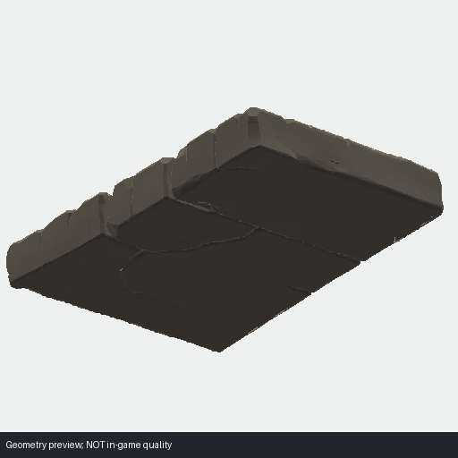

**Uso registrado:** stone sheet modular subset. **Clasificación:** `REUSE_CONDITIONAL`.

**Archivo:** `Unity/Assets/Eldoria/Resources/Valoria/StoneKit/piece_01_10364tris.glb`.

**Limitación:** Six preserved separated modules, not proof of final artistic approval for arbitrary compositions..

## piece_02_12602tris

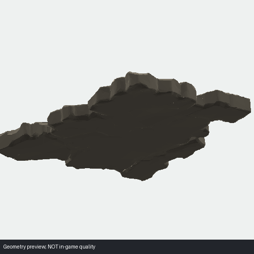

**Uso registrado:** stone sheet modular subset. **Clasificación:** `REUSE_CONDITIONAL`.

**Archivo:** `Unity/Assets/Eldoria/Resources/Valoria/StoneKit/piece_02_12602tris.glb`.

**Limitación:** Six preserved separated modules, not proof of final artistic approval for arbitrary compositions..

## piece_03_6433tris

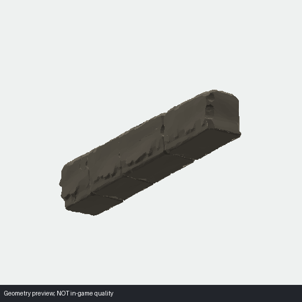

**Uso registrado:** stone sheet modular subset. **Clasificación:** `REUSE_CONDITIONAL`.

**Archivo:** `Unity/Assets/Eldoria/Resources/Valoria/StoneKit/piece_03_6433tris.glb`.

**Limitación:** Six preserved separated modules, not proof of final artistic approval for arbitrary compositions..

## piece_04_7824tris

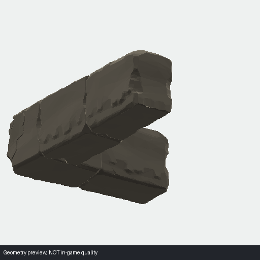

**Uso registrado:** stone sheet modular subset. **Clasificación:** `REUSE_CONDITIONAL`.

**Archivo:** `Unity/Assets/Eldoria/Resources/Valoria/StoneKit/piece_04_7824tris.glb`.

**Limitación:** Six preserved separated modules, not proof of final artistic approval for arbitrary compositions..

## piece_05_4966tris

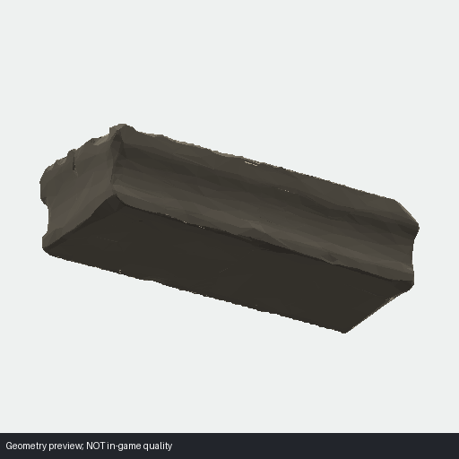

**Uso registrado:** stone sheet modular subset. **Clasificación:** `REUSE_CONDITIONAL`.

**Archivo:** `Unity/Assets/Eldoria/Resources/Valoria/StoneKit/piece_05_4966tris.glb`.

**Limitación:** Six preserved separated modules, not proof of final artistic approval for arbitrary compositions..

## piece_06_7602tris

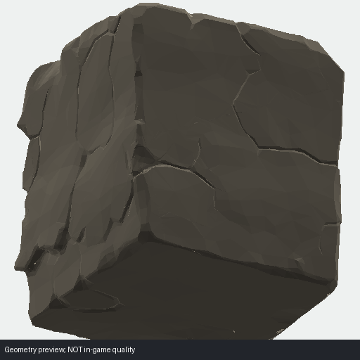

**Uso registrado:** stone sheet modular subset. **Clasificación:** `REUSE_CONDITIONAL`.

**Archivo:** `Unity/Assets/Eldoria/Resources/Valoria/StoneKit/piece_06_7602tris.glb`.

**Limitación:** Six preserved separated modules, not proof of final artistic approval for arbitrary compositions..

## BroadRockPlatform

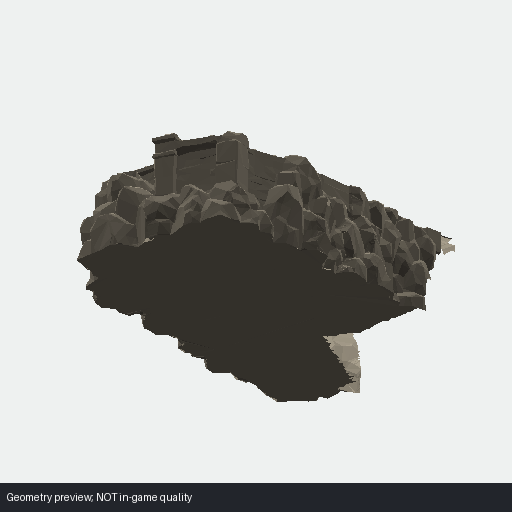

**Uso registrado:** Valoria buried rock/terrace support. **Clasificación:** `REUSE_CONDITIONAL`.

**Archivo:** `Unity/Assets/Eldoria/Resources/Valoria/TerrainTerraceKit_v1/BroadRockPlatform.glb`.

**Limitación:** Use only buried or top-aligned; do not turn into huge rejected cliffs..

## SteppedRockTerrace

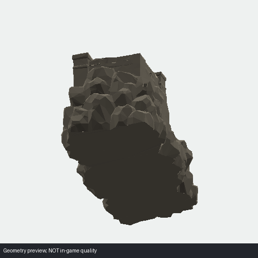

**Uso registrado:** Valoria buried rock/terrace support. **Clasificación:** `REUSE_CONDITIONAL`.

**Archivo:** `Unity/Assets/Eldoria/Resources/Valoria/TerrainTerraceKit_v1/SteppedRockTerrace.glb`.

**Limitación:** Use only buried or top-aligned; do not turn into huge rejected cliffs..

## Valoria_Aserradero_AP2_v1

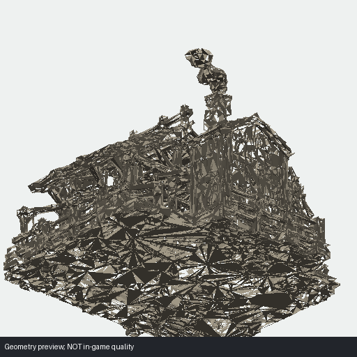

**Uso registrado:** Valoria sawmill. **Clasificación:** `USE_PRODUCTION`.

**Archivo:** `Unity/Assets/Eldoria/Resources/Valoria/Valoria_Aserradero_AP2_v1.glb`.

**Limitación:** Dedicated production aserradero..

## Valoria_Cuartel_AP2_v1

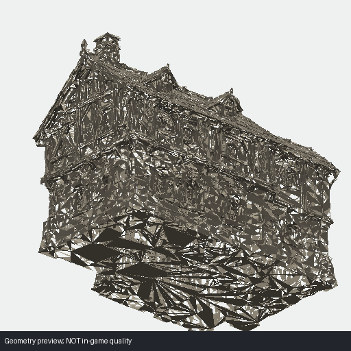

**Uso registrado:** Valoria barracks. **Clasificación:** `USE_PRODUCTION`.

**Archivo:** `Unity/Assets/Eldoria/Resources/Valoria/Valoria_Cuartel_AP2_v1.glb`.

**Limitación:** Dedicated production cuartel..

## Valoria_Granero_BIII_v1

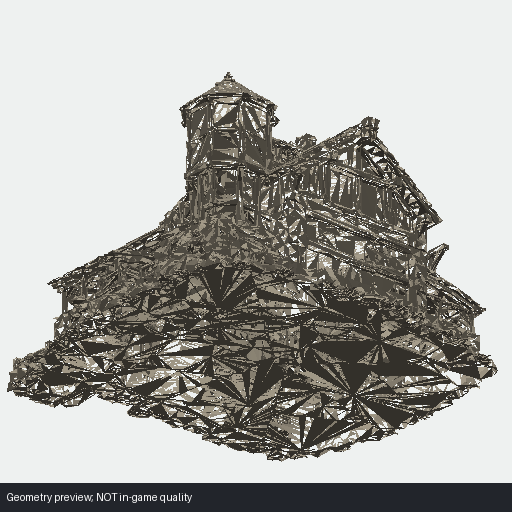

**Uso registrado:** Valoria granary (Bastion III art source). **Clasificación:** `USE_PRODUCTION`.

**Archivo:** `Unity/Assets/Eldoria/Resources/Valoria/Valoria_Granero_BIII_v1.glb`.

**Limitación:** Production asset, not permission to activate Bastion III gameplay..

## PlayerCity_v1

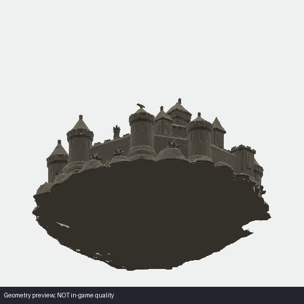

**Uso registrado:** 4X strategic player city. **Clasificación:** `USE_PRODUCTION`.

**Archivo:** `Unity/Assets/Eldoria/Resources/WorldPlayerCity/PlayerCity_v1.glb`.

**Limitación:** Universal strategic player-city mesh with identity/state separate..

