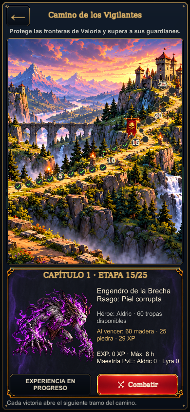
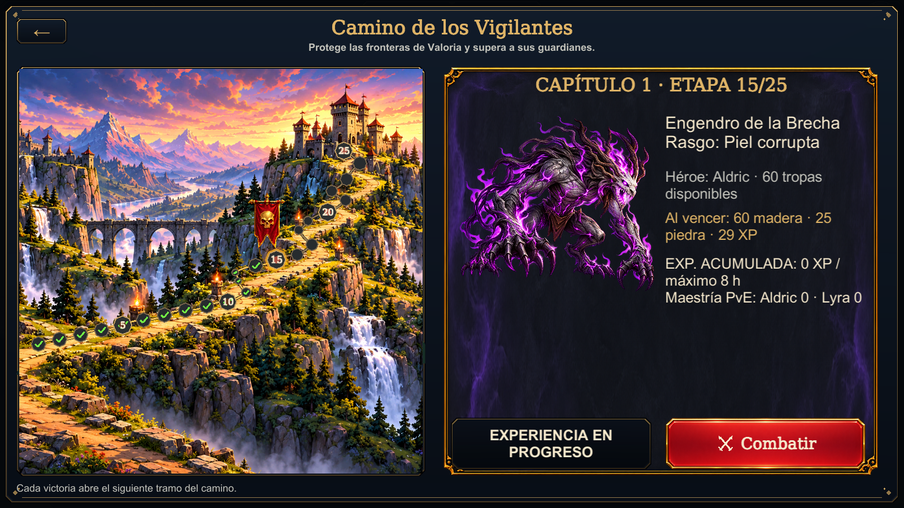
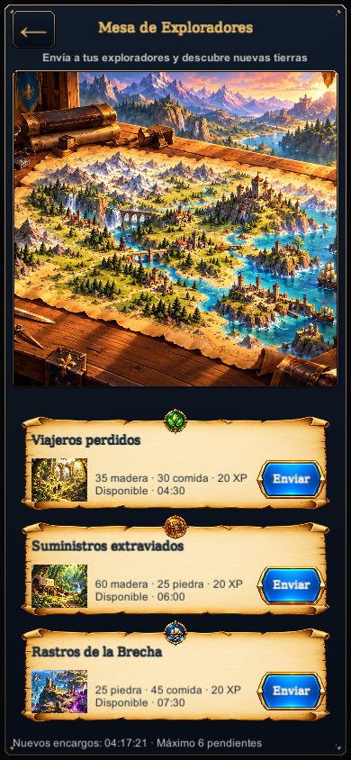

# PR120 — revisión de referencia y validación nativa

Fuente Unity: `fa028667e1e7d8492276c921efc7d49379c450c1`.
[Unity nativo40755121692](https://github.com/mt5hjfz2kb-lab/Eldoria-Prewiu/actions/runs/40755121692): SUCCESS,
13 pruebas de dominio,19 capturas reales, combate/tres envíos/tres cobros/XP,
retorno y recarga persistida. Artefacto12845374533,
SHA256 ZIP `6fde5439aa62e4b5ae94e595717c15edf3ebd5d76be613ef4c3540c342b7dbbd`.

Se abrieron individualmente las19imágenes originales del artefacto y se
compararon con [la referencia seleccionada](reference-selected.png). La revisión
acepta la composición/materialidad/jerarquía de estas dos interfaces2D:
camino iluminado con fortificación,25hitos reales y progreso, estandarte del
guardián actual, gran Engendro blanco/violeta, ficha ornamental y acción roja;
mesa de cartógrafo con tres pergaminos, escenas y medallones distintos por tipo
real, estado y acciones azules. Las primeras etapas también tienen ilustración.
La composición se adapta a cada orientación conservando datos legibles y
controles auténticos; no se atribuye igualdad píxel por píxel entre formatos.

En1600x900 Vigilantes presenta ruta completa a la izquierda y ficha a la
derecha; en vertical, escena encima de la ficha. Exploradores conserva tres
cartas en columnas en horizontal y tres contratos apilados en vertical.
Se revisaron390x844 y844x390 además de900x1600/1600x900. Todos los textos
visibles caben y alcanzan al menos12píxeles reales en teléfono. Victoria,
encargos en camino y listos para recoger reconocen estados del gateway,
sin controles de adorno que intercepten las pulsaciones. Un salto artificial
UTC del probe espera a que expire el anuncio real antes de la captura lista.

Las recompensas existentes siguen siendo provisionales por decisión del
propietario. No se copian gemas, poderes o duraciones ficticias del concepto.
No se certifica dispositivo físico, perfil Android o nuevo arte3D; la revisión
es de UI2D nativa y funcionamiento/persistencia. El campo formal de ciclos3D
ART_APPROVED se conserva separado, sin atribuir inferencia Qwen ni modelo nuevo.

El [manifiesto de capturas](evidence/native36/capture-manifest.json) fija las19
huellas y la referencia exacta. Tres PNG originales se conservan aquí:

Certificación compartida:47Edit/72Play, run40731703310. Prototipo web completo:
run40731703240, incluye recorrido ininterrumpido de partida nueva hasta cierre.
Ambos compilaron/probaron el árbol20d1cf del mergefd0967, idéntico a su fuentebd0.
Los controles40755718634 y40755718645 comprobaron reutilización estricta de
entradas y de los jobs completos byte por byte. Ninguna prueba fue desactivada.
Los cambios finales de evidencia/pins/registros conservan el árbol Unity exacto.
