# Eldoria — producción artística integrada, cierre 21-10-2026

Estado: CUATRO FASES INTEGRADAS Y VALIDACIÓN FUNCIONAL FINAL COMPLETADA; objetivo artístico global de ciudad todavía no certificado. Rama única main; sin publicación ni sustitución del playtest anterior. Escena canónica: `Unity/Assets/Eldoria/ArtTests/ValoriaReferenceClean/Integration/Valoria_City_World_UI.unity`, SHA-256 `4c8bbdc6ccb1273bcf24c0e94fa102d88077faac71869598a0e215b88a1cb2bb`.

## Resultado y trazabilidad

| Fase | Obra conservada | Evidencia Unity |
|---|---|---|
| Terreno y ribera | Relieve bajo, ribera continua, apoyos, transiciones; roca reautorizada con 45.974 triángulos menos | native200 / 39450899545; native226 / 39485567981: 40 comprobaciones |
| Puente, puerta, Bastión | Apoyos de piedra originales, pizarra azul; cubierta existente ajustada entre torres, terrazas cerradas y etapas I–II conservadas | native203 / 39453446158; native233 A/B / 39491046549; native234 / 39492819273; persistencia native241 / 39506119472 |
| Bosque y cantera | Tres coníferas originales con ramificación, atlas y LOD; frente excavado con estratos, escombro y extracción; plataforma asentada sobre terreno real | native210 / 39459840985; native229 / 39487451858: 16 renders idénticos y 40 comprobaciones |
| Brecha y ciudad funcional | Fracturas contenidas, entorno del aserradero/cuartel ligado a sus desbloqueos, árboles y contactos de ciudad; corrección de sombras del mundo | native216 / 39469515439: 40 comprobaciones; native229 |

Las tiendas enemigas ya estaban inactivas en la fuente: no se atribuye su supresión a esta misión. No se han añadido barrios, campamentos ni Bastión III. Las cuatro parcelas siguen invisibles. Los cambios de cámara del mundo solo reducen distancia en profundidad 350→140 para entrar en las sombras URP existentes: proyección XY y zoom conservados, error máximo medido 1,19×10⁻⁷.

## Imágenes auténticas

Ciudad al inicio:

Ciudad integrada, Bastión I:
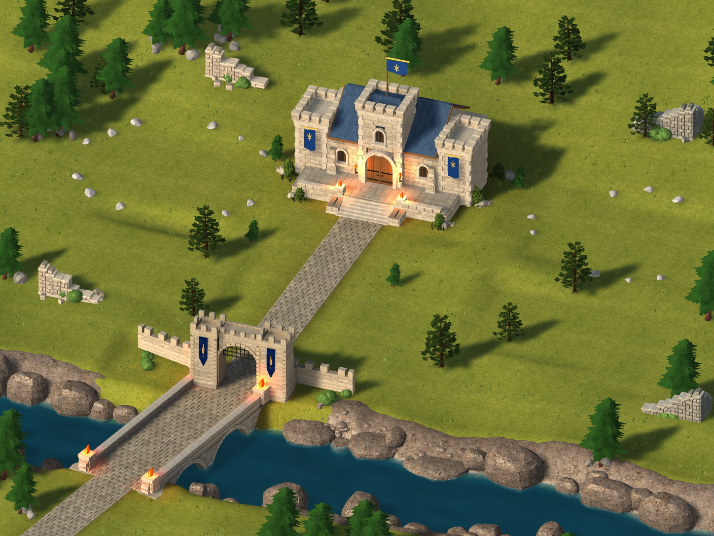

Bastión II y edificios desbloqueados:
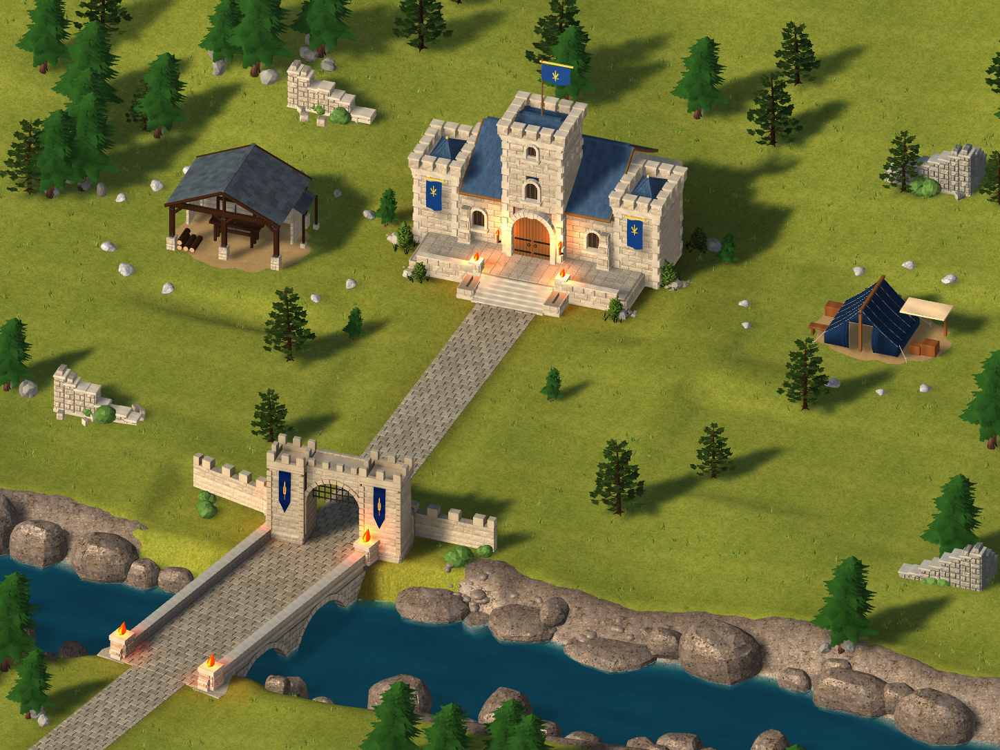

Encuentro de cubierta anterior:
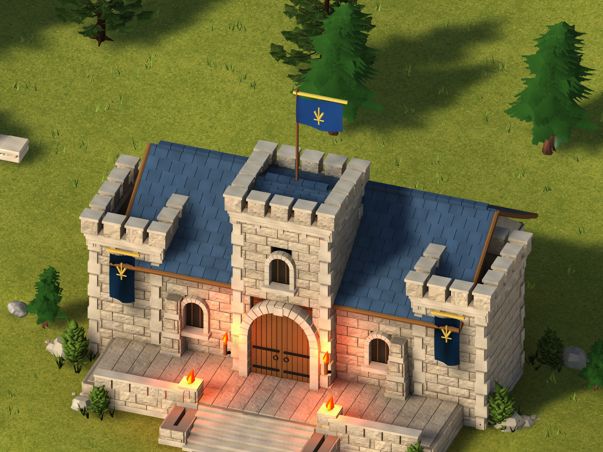

Encuentro de cubierta corregido:
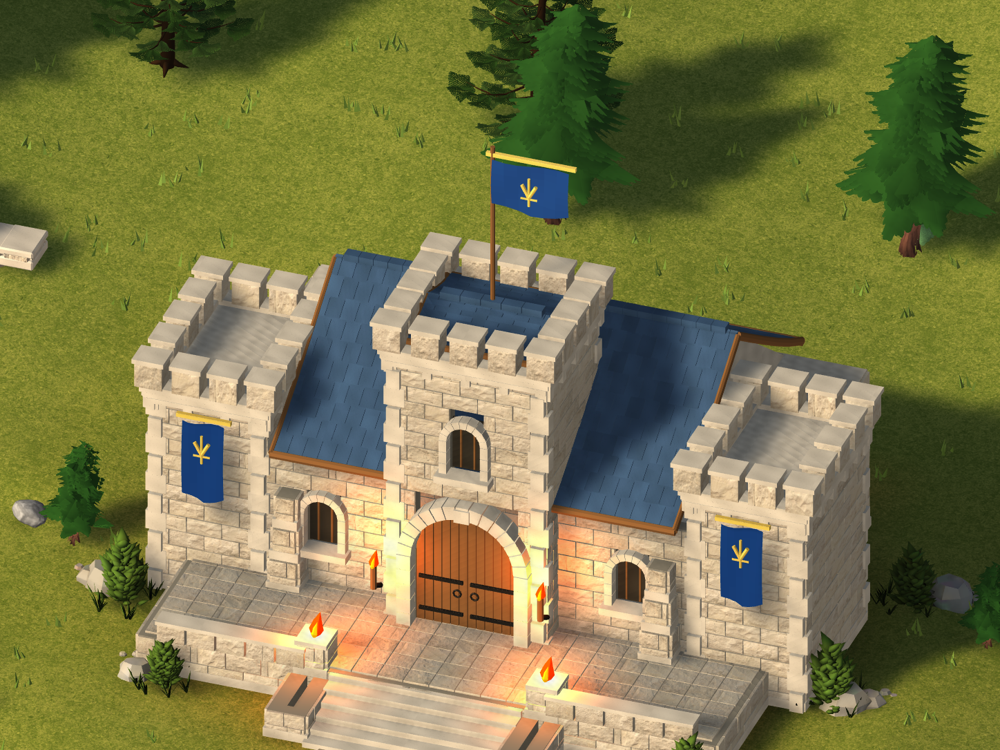

Vista vertical:
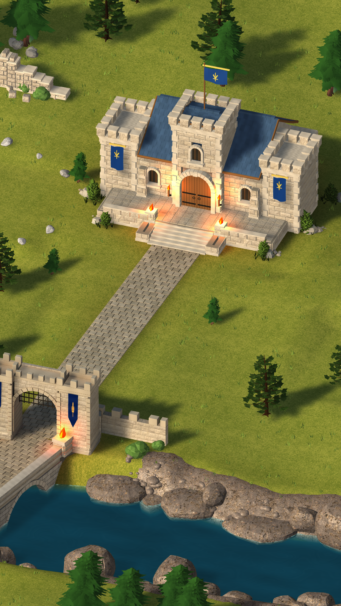

Cantera anterior:

Cantera integrada:
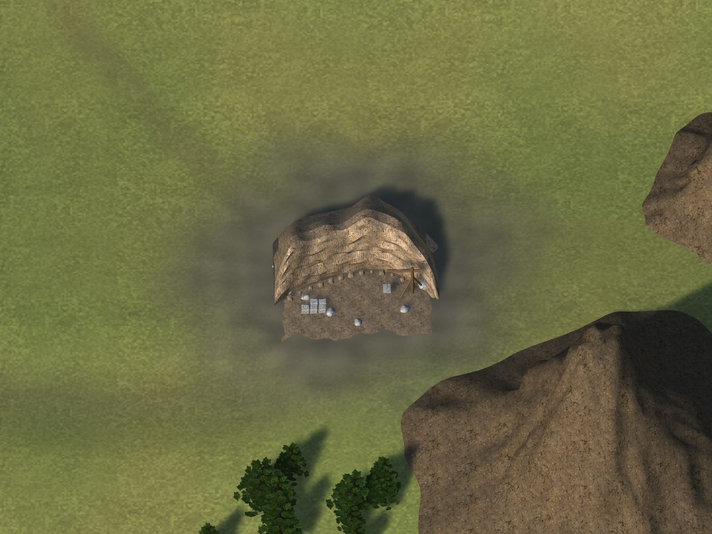

Bosque integrado:
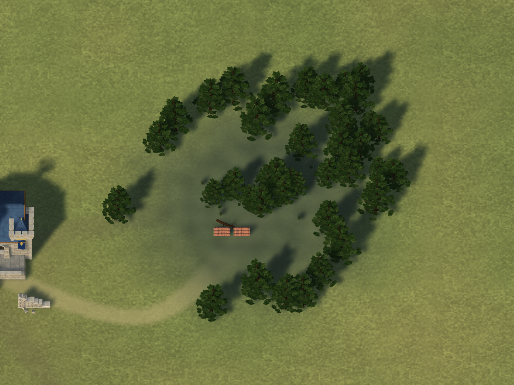

Lenguaje visual de la Brecha:
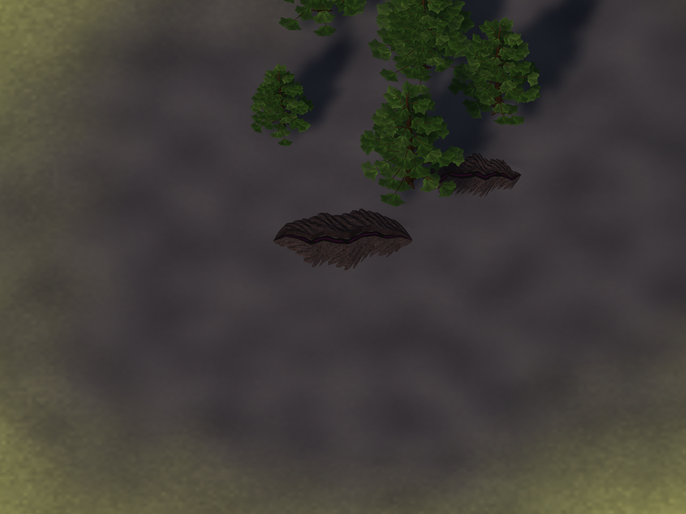

Cada intervención tiene cámaras comparables, hashes y aceptación específica en sus carpetas. La reapertura descubrió que el atlas horneado antiguo volvía a asignarse a los componentes originales del Bastión, oscureciendo sus nuevas terrazas. Native238 corrige las identidades de renderizado y restituye cuatro luces en sus posiciones originales; se conserva la geometría y se desactivan los componentes antiguos. El acabado se acepta tras revisar las seis vistas reales, y native241 confirma las seis comparaciones después de guardar/reabrir (error medio máximo 0,0010605/255; dos detalles de cubierta idénticos píxel a píxel). Las cuatro luces pasan a tiempo real sin sombras: no aumenta el número de luces activas ni se añaden mapas de sombra, pero sí existe coste adicional de iluminación que no se certifica en móvil. Native239 detectó además una diferencia de alfamapa GPU frente al TerrainData serializado; native240 fijó el asset guardado antes de capturar y native241 reutilizó exactamente sus bytes, sin relajar ningún gate. Los hombros del camino mejoran su transición material; native235 midió que no faltaba contacto de altura, por lo que se mantuvieron relieve y colisión.

La referencia exacta permanece `references/VALORIA_APPROVED_VISUAL_REFERENCE.jpg`, SHA-256 `86fbffa9410514e935b121a844802573cbb7f94c73abb7358ce2f8ee15845c5d`. Sus cuatro parcelas son la excepción explícita del propietario.

## Evaluación artística

Revisión directa de capturas Unity a resolución completa, con comparación contra el JPEG aprobado y las imágenes previas de cada fase. La ciudad presenta un salto visible: la cubierta ya no atraviesa las terrazas, la ribera tiene continuidad y contacto, los árboles pequeños dejan de parecer conos apilados y el conjunto mantiene su composición. La valoración visual propia se sitúa aproximadamente entre 6,5 y 7/10, cerca del primer objetivo; no permite afirmar un mínimo objetivo certificado de 7. El mundo, especialmente bosque y cantera, se sitúa aproximadamente en 5,5–6/10: supera claramente su representación provisional, con límites visibles en suelo y sombras. Estas estimaciones no son una escala calibrada y no certifican producto comercial terminado.

La crítica local independiente está conservada íntegra: `production-final-independent-review.json` (ciudad/mundo) y `production-final-city-review.json` (ciudad final). El modelo da 6,5 a ciudad y mundo, pero la revisión final afirma falsamente que existen cuatro parcelas visibles; se rechaza esa observación frente a las imágenes y los checks, sin alterar el informe ni forzar una nota superior. Tampoco sustituye la inspección directa. Las notas iniciales 5,3/3,4 siguen siendo orientativas del propietario, no mediciones certificadas del antes.

Limitaciones visibles: pradera todavía repetitiva; bordes de camino rectos; sombras amplias; textura base del mundo poco detallada; amenazas sobrias y parecidas entre sí. La referencia 10/10 conserva mayor riqueza de suelo, vegetación y luz. No presentar una estimación como certificación ni las puntuaciones orientativas iniciales como medición calibrada.

Se rechazaron los ensayos de roca sin mejora, Brecha radial/neón y las cubiertas native230–231 con deformaciones o huecos. Se conserva el ajuste medido native232, integrado en native234 y completado por la corrección de iluminación persistente native238–241. Añade 48 triángulos por etapa del Bastión; no atribuirle la reducción de triángulos de la ribera.

## Fuentes reutilizables

- `terrain-bank192/TerrainBank192.blend`; `terrain-polish218/RiverbankWeathered.blend`.
- `architecture201/BridgeAbutments.blend`.
- `roof-junction226/BastionRoofJunctions.blend` (67.105.462 bytes), GLB I/II, fuente/candidato y operaciones con hashes.
- `world204/ConiferFamily.blend`, atlas y LOD; `QuarryGeologyV18.blend` en la raíz de esta carpeta de evidencia.
- `finish211/BreachGround211.blend`.
- Autoría en `tools/valoria-reference-clean/author_*.py`; integración y fuentes medidas en los helpers existentes.

Fuentes editables conservadas, no solo imágenes. No se entrenó ningún modelo ni se usaron servicios o créditos de pago.

## Validación final

- Unity native241 [39506119472](https://github.com/mt5hjfz2kb-lab/Eldoria-Prewiu/actions/runs/39506119472): 40 comprobaciones PASS y PlayMode real completado. Seis comparaciones antes de guardar y seis tras reabrir PASS; error medio máximo tras reapertura 0,0010605/255. Los dos detalles de cubierta son idénticos píxel a píxel.
- WebGL native242 [39506996242](https://github.com/mt5hjfz2kb-lab/Eldoria-Prewiu/actions/runs/39506996242): compilación SUCCESS, fuente `f8e294dda9a829316eb0dec764f8e2b1ce7d20d0`; seis archivos, 216.539.383 bytes descomprimidos. ZIP [12303829447](https://github.com/mt5hjfz2kb-lab/Eldoria-Prewiu/actions/runs/39506996242/artifacts/12303829447), SHA-256 `d027ea0fa69f3f2cbc29b2063f130219b01592d73c47155c3bcbe74556c9f618`, descargado y verificado.
- La prueba de navegador de native217 es histórica: no se utiliza para certificar esta escena final. La ruta Windows usa los bytes nuevos de native242 y conserva las mismas comprobaciones estrictas; no vuelve a compilar Unity.
- Windows Chromium/Edge [39509184788](https://github.com/mt5hjfz2kb-lab/Eldoria-Prewiu/actions/runs/39509184788): **PASS**, 159,85 s a reloj normal, horizontal/vertical, construcción, recolección, entrenamiento, combate/recompensas, navegación en cuatro direcciones, zoom y persistencia. Cero errores runtime y cero fallos de red. Guardado antes/después idéntico: `0ee7b91db0680c5f0a3e45d8aa935db675fa0aad51b6caefdad51caa7f19e96d`.
- [Informe completo](web242/report.json), [manifest de bytes probados](web242/build_manifest.json), 72 capturas directas del compositor, ninguna pendiente. Seis imágenes representativas copiadas a `web242/screenshots/`; el [artefacto completo](https://github.com/mt5hjfz2kb-lab/Eldoria-Prewiu/actions/runs/39509184788/artifacts/12305530711) contiene vídeo y todas las capturas. SHA-256 del informe original: `a7a23478ee2b1e2df7a9151ce301023e63a977600f3e026b6dae6e53cb5330aa`.
- Límite específico del harness: el clic temprano sobre el collider de puerta no se intentó por quedar fuera del encuadre; su regresión nativa es separada. No se presenta como comprobación de navegador superada.
- Paquete probado conservado como [artefacto privado](https://github.com/mt5hjfz2kb-lab/Eldoria-Prewiu/actions/runs/39509184788/artifacts/12304528775); no desplegado.

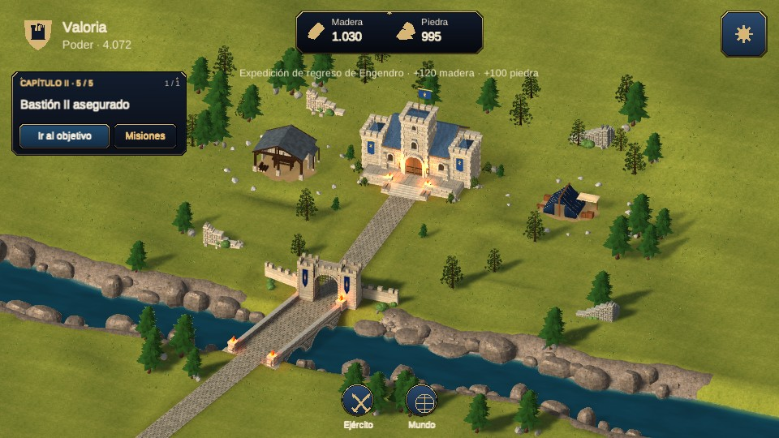
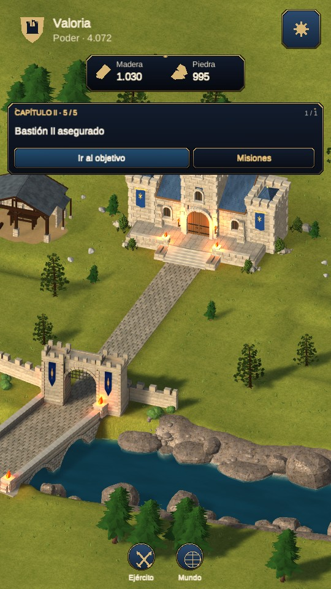
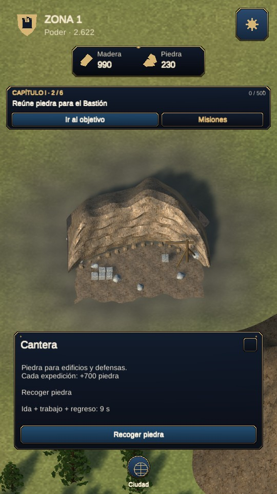

No se ha certificado rendimiento Android/iOS en dispositivos físicos. Las vistas verticales y la entrada táctil emulada no equivalen a una prueba física. No se ha publicado esta entrega ni reemplazado ninguna versión del propietario.
