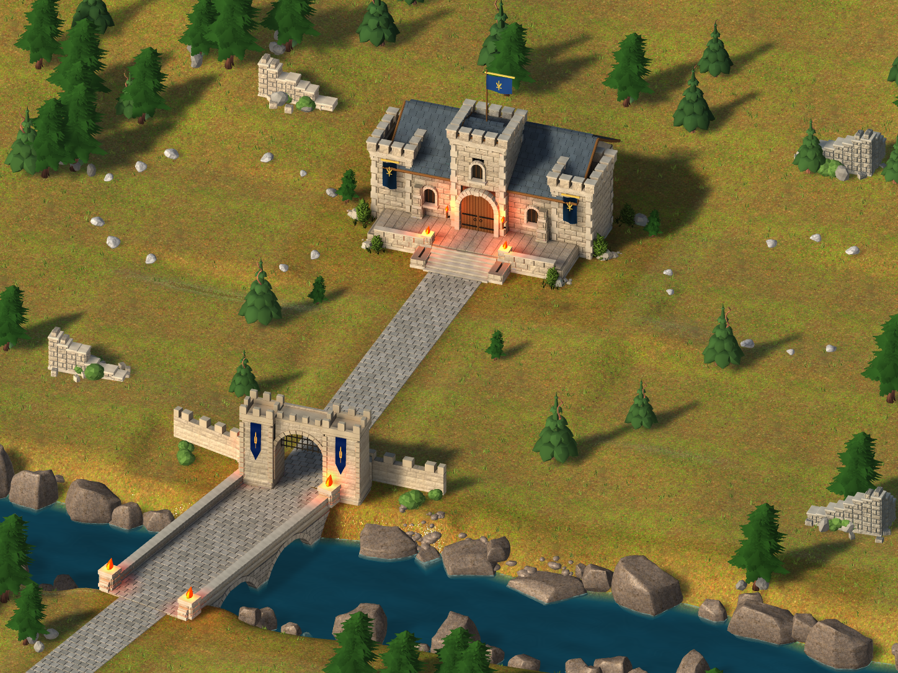
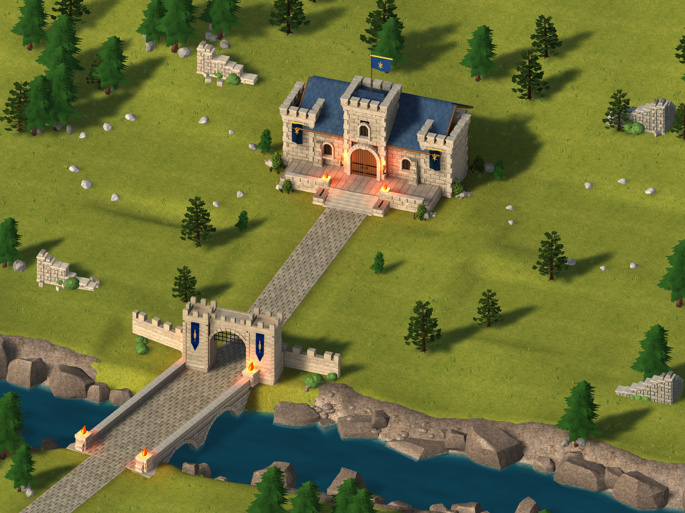
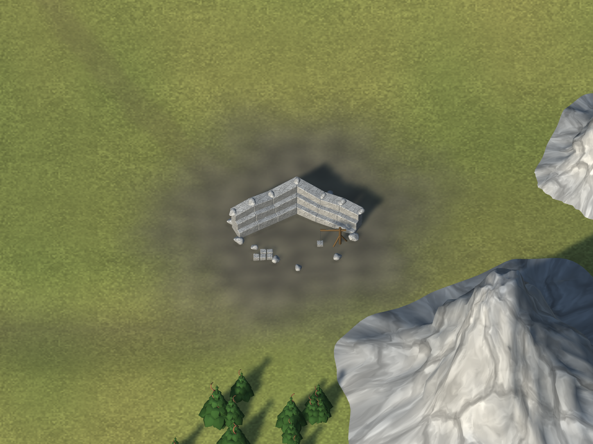
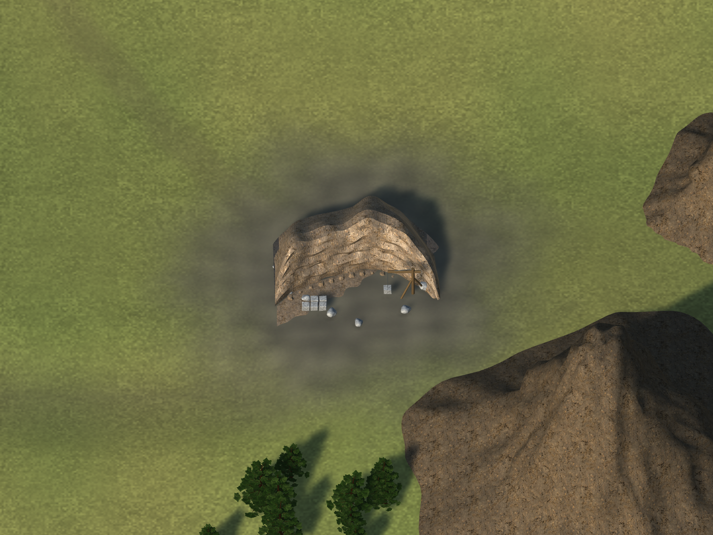

# Eldoria — producción artística integrada, 20-10-2026

Estado verificable: cuatro intervenciones integradas en main, sin publicación. Escena `Unity/Assets/Eldoria/ArtTests/ValoriaReferenceClean/Integration/Valoria_City_World_UI.unity`, SHA-256 `305dc0dd0cb010291dcd3aa52bdea12c02c91dd10b0187f167673fab5a48768b`, commit de escena `d1ed49ddfbcdb0288696e6229443c8e7beac62cf`.

## Producción y evidencia

| Fase | Mejora conservada | Integración real Unity |
|---|---|---|
| Terreno y ribera | Relieve bajo, terreno protegido en accesos, ribera continua con roca apoyada, transición de suelo | [native200](https://github.com/mt5hjfz2kb-lab/Eldoria-Prewiu/actions/runs/39450899545), 35 checks |
| Puente, puerta y Bastión | Retornos de apoyo modelados, continuidad pétrea, pizarra azul y materiales; I–II conservados | [native203](https://github.com/mt5hjfz2kb-lab/Eldoria-Prewiu/actions/runs/39453446158), 35 checks |
| Bosque y cantera | Tres coníferas ramificadas con atlas/LOD; frente excavado, estratos, escombro y grúa anterior | [native210](https://github.com/mt5hjfz2kb-lab/Eldoria-Prewiu/actions/runs/39459840985), 35 checks + 4 capturas |
| Brecha y acabado | Fracturas bajas con veta violeta; 18 coníferas de ciudad reutilizadas; apoyos de edificios desbloqueados; agrupación de roca; UV/piedra de tres montañas existentes | [native216](https://github.com/mt5hjfz2kb-lab/Eldoria-Prewiu/actions/runs/39469515439), 40 checks |

Native216: trece comparaciones del candidato aprobado antes de guardar. Nueve renders de mundo idénticos; cuatro de ciudad con diferencia media temporal máxima 0,04765/255, dentro de tolerancia documentada. Progresión I–II, construcción, reclutamiento, recursos, navegación, combate, recompensas, UI y hashes de guardados canónicos pasaron. Las cuatro capturas adicionales de destinos quedaron tapadas por un diálogo diferido tras la recarga: NO son prueba de revisión despejada. El harness se corrigió para esperar y comprobar inmediatamente antes de capturar; verificación pendiente en native217.

## Comparación visual

Ciudad antes del bloque de producción:

Ciudad candidata aceptada e integrada:

Cantera antes:

Cantera y entorno después:

Las comparaciones de cada fase fijan cámara, iluminación, fuentes y hashes en sus accepted-candidate.json. Las imágenes son capturas Unity, no renders inventados. La referencia oficial conserva SHA-256 `86fbffa9410514e935b121a844802573cbb7f94c73abb7358ce2f8ee15845c5d`; sus cuatro parcelas permanecen excluidas por orden del propietario.

## Veredicto artístico y límites

Mejora visible y aceptada por intervención, separada de los resultados técnicos de Unity y de Qwen. Se descartaron la ribera aplastada, las copas inferiores, la Brecha radial y la franja de neón. La ciudad gana continuidad y coherencia; bosque y cantera se distinguen por su geometría; las amenazas ya poseen un motivo de terreno permitido por el lore. Los campamentos enemigos ya estaban desactivados en la fuente, no atribuir esa supresión a esta fase.

No se certifican automáticamente 7/10 ni 5,5/10. Persisten margen artístico en transición de pradera, naturalidad de algunos bloques de ribera, encuentro lateral de cantera y detalle de amenazas. Las notas iniciales del propietario eran orientativas y no constituyen una medición calibrada. No hay rendimiento certificado Android/iOS: disponibilidad observada, cero Android autorizados y ninguna prueba física realizada.

## Fuentes reutilizables

- `terrain-bank192/TerrainBank192.blend` y `tools/valoria-reference-clean/author_terrain_bank.py`.
- `architecture201/BridgeAbutments.blend` y `author_architecture_finish.py`.
- `world204/ConiferFamily.blend`, atlas, geometría/LOD y `author_forest_canopy.py`.
- `QuarryGeologyV18.blend` y `author_quarry_geology_v18.py`.
- `finish211/BreachGround211.blend` y `author_breach_ground.py`.

Operaciones, hashes y resultados de autoría permanecen en las carpetas de evidencia correspondientes. Integración final en `Integration/FinalEnvironment212`, conservando `TerrainBank197`, `Architecture202` y `WorldArt208`.

## Validación WebGL

PENDIENTE — native217, run39470143984, fuente74b5fb8518fe0bbf89a1c233af65466ed41830be. Compilación exacta y QA de controles visibles del flujo existente. No publicar ni sustituir el playtest anterior.
